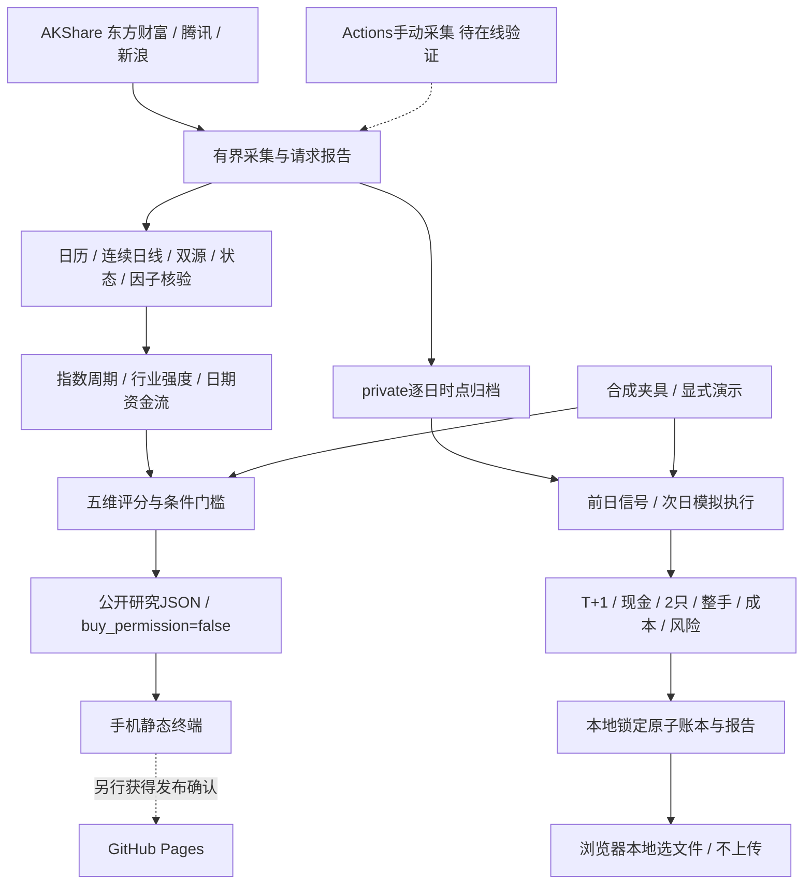

# 第二阶段架构与数据契约

目标产品V3.1，当前包0.2.0。范围是7只初始自选与可选最多100只主板代码；尚未全市场扫描。

## 来源与标准化

真实日历来自新浪；缺失/格式/覆盖不合格阻断。日线16:00后要求当天完整交易日，否则上一个；人工工作日日历只用于demo测试。

股票价格为东方财富 `stock_zh_a_hist` 与腾讯 `stock_zh_a_hist_tx` 未复权；指数东方财富 `index_zh_a_hist` 与新浪 `stock_zh_index_daily`，新浪空时再探测腾讯。只选完整同源序列，不拼接。名称、ST/退市与行业来自当期 `stock_individual_info_em`，失败不硬编码名称。

至少60根连续正有限OHLC/成交量，OHLC合理、真实日历成员、无未来/重复/乱序/缺口、末日一致，>12%收盘跳变阻断。近20日两个独立来源OHLC最大相对偏差≤0.1%才通过；单来源允许显示观察值，不能产生研究许可。

内部量口径：东方财富手×100；腾讯个股股数原值；腾讯指数 `amount` 实为量（手）×100；新浪指数保持原生股数口径。不同来源的量不作相等承诺，量比只在同源计算。依据[AKShare股票](https://akshare.akfamily.xyz/data/stock/stock.html)、[指数](https://akshare.akfamily.xyz/data/index/index.html)文档。

比较近60日未复权/腾讯前复权收盘因子，最大相对变化≤0.5%为稳定。缺失、变化、末日不一致阻断；所有信号/成交使用原始价，不把今日前复权价用于过去成交。该检查是保守代理，不能证明完整公司行为；没有分红/拆并股记账，显式事件拒绝回测。

个股资金 `stock_individual_fund_flow`、行业 `stock_sector_fund_flow_hist` 必须含日期/主力净额（元）/净占比（%）；最近5真实交易日连续、末日一致、数值有限且占比≤100%。不使用无日期即时榜填历史。行业价格 `stock_board_industry_hist_em`；证券归属标记有效日、可知时间与来源，只能在当时采集的归档里用作时点依据。

## 数据格式与隐私

| 契约 | 内容与边界 |
| --- | --- |
| `raw-2` | 模式、采集时刻、日历、当期池、指数/股票/行业、元数据、资金、来源、交叉与因子检查、报告；原始归档private |
| 公开 `2.0` | 指标、五维分值、质量、研究许可、预算测算、来源/延迟/有效期；无账户账本 |
| `replay-2` | 升序逐日raw-2快照；mode/source/corporate_actions/universe_policy；真实为point_in_time_archive，demo为fixed_watchlist_demo |
| `paper-2` | kind=simulated_only，初始50万分、现金/持仓/成交、信号与日期去重、模式绑定；private |
| `backtest-2` | 模拟指标/成交/曲线/警告/期末账本；强制private；公开演示仅白名单字段、省略账本 |

时区Asia/Shanghai；采集允许最多60秒未来误差、36小时年龄；元数据目标日有效。公开有效期为生成+36小时和下一交易日16:00的较早者；原始采集已过期仍直接阻断，浏览器每分钟二次检查。

## 指标与实验规则

MA5/10/20/30；MACD12/26/9、柱×2；量比当日/此前5日均量。指数A为三者close>MA20且柱>0，B为1–2个，C为0个，任一质量失败UNKNOWN。

行业20（>MA20 8、5日正6、胜上证6），资金20（当日净额正6、5日合计正8、当日占比正6），趋势25（>MA20 10、MA5≥MA10≥MA20 10、柱正5），候选20，模型账户适配15。缺项总分null，不把60折算100。

热点过热为距MA20>10%或5日涨>12%；正价格势、当日/5日正资金为启动/延续（依前一5日价格）；5日价/资金同负退潮；其他分化。主线要求行业≥14、5日至少3日正资金、启动/延续；限自选所属行业。

趋势回踩要求MA5≥MA10≥MA20≥MA30、low≤MA10×1.015、close≥MA10、量比≤1。突破回踩要求此前2–6根close突破其前20根high 0.5%，今日low接近原阻力且close仍在其上并保持均线趋势。止损最近5日low×0.99按分四舍五入。

live研究许可要求A、主线、资金≥14、趋势≥20、候选、整手风险测算、总分≥80及所有质量通过。公开buy_permission=false是账户隔离边界；本地模拟重新检查，不连接真实交易。

## 模拟执行

只用前日快照形成信号，执行日09:30前已可知；执行日OHLC/状态用于收盘后事后验证，不用当日指标重排买入。今天下载过去价格无法补造过去资金/状态；连续采集时点档案才能重放。

现金分记账、买价上取分、卖价下取分。含双边成本计划损失≤5000分，单股预算≤250000分，不能透支；按前日分数降序、同分代码排序逐笔重算，最多2只、不加仓。

当日不能卖（T+1），触发止损只记警告。前日确认C或10交易日到期的开盘退出优先，然后才模拟日内止损；跳空按更不利开盘。成熟非ST主板±10%；涨停开盘不买、跌停开盘不卖、一字不成交、滑点价越日内区间不成交。没有盘口，成交仍是模型。

2022-04-29前费用拒绝，2023-08-28税率分段；收费假设见README。收益含开放持仓收盘估值、不扣未来卖费。持仓缺报价/执行质量时保留旧估值并标记，收益/回撤/胜率留空。

同日推进幂等、账本绑定数据模式、fcntl锁与原子替换；损坏拒绝，现金/股数与事件守恒。账本/CSV/归档/回测路径解析后限制于项目private，包括拒绝符号链接逃逸到site。

## 阶段与运维

CI离线检查，手动collect只产公开工件；无定时、Pages停用。第二阶段代码完成不代表真实全链路已通过，也不构成发布授权。报告后暂停。下一阶段先验证免费数据/Actions可用性与真实时点样本，再安排全市场扫描和经确认的上线。
